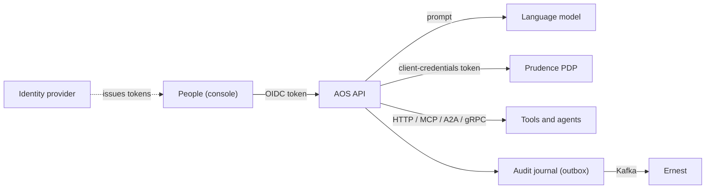

# AOS Threat Model

AOS turns a request into one of a fixed set of pipelines and runs it under control. This document
states what it guarantees, what each guarantee rests on, what it does not guarantee, and what an
operator must do.

## What AOS is

An orchestrator of **predefined** pipelines written as YAML (`definitions/`): intents, pipelines,
tools and RBAC. A language model helps pick the intent and extract parameters; it never writes a
pipeline. A pipeline that belongs to an AI system asks **Prudence** before it starts (AOS is the
policy enforcement point); human steps pause a run for a person's decision. Steps call tools over
HTTP, MCP, A2A or gRPC. Every run is written to a hash-chained **audit journal**, which is also
the outbox that ships execution evidence to **Ernest** over Kafka. Who may run, decide or read
comes from the organization's **governance model** (contract `chestertown.governance/v1`).

## Assets

- Pipeline, intent, tool and RBAC definitions (they decide what can run at all).
- Task state, clarifications and human decisions.
- The audit journal and its Kafka cursor.
- Credentials: the PDP client secret, LLM provider keys, tool credentials, Kafka credentials.
- The governance model file (`AOS_GOVERNANCE_MODEL`).

## Trust boundaries

The language model and the tools are outside the trust boundary: their output is data, never
authority.

## Guarantees, and what each rests on

**G1 — No governed run without ALLOW.** A pipeline with an `ai_system` starts only after Prudence
answers `ALLOW`. `DENY`, `APPROVAL_REQUIRED`, `ERROR`, an unreachable PDP or a failed token request
all block it (fail closed). Rests on: `PRUDENCE_PDP_*` being configured for every governed
pipeline.

**G2 — Only defined pipelines run.** The model chooses among the intents AOS sends it; the
chosen pipeline, its tools and its parameters are validated against the definitions before
anything executes (unknown tools, dangerous parameter values and dangerous tool chains are
refused). Rests on: the definitions being reviewed like code.

**G3 — Authorization by function.** A token from the identity provider resolves to functions;
one that resolves to none is refused with 403. `ai.use:<domain>` runs only the intents RBAC grants
that domain (unknown intents are denied); a human step is decided by `oversight`, or by the
requester unless the model makes `ai.use` and `oversight` incompatible; only the requester answers
a clarification; other people's tasks are visible to `oversight` and `audit` only.

**G4 — Tamper-evident record of every run.** Each journal entry's hash commits to its sequence,
the previous hash and the full event; the pipeline manifest is recorded before execution.
`aos -verify-audit` checks the chain and `-verify-trace` one execution. The journal ships to Ernest
with a cursor that advances only on acknowledgement, so evidence is late, never lost while the
journal survives.

**G5 — Outbound calls stay outside the private network.** Tool calls to private, loopback,
link-local or multicast addresses are refused unless the host is named in
`AOS_TOOL_INTERNAL_HOSTS`. Rests on: that list staying short.

## What AOS does NOT guarantee

**N1 — The model can choose the wrong allowed pipeline.** Prompt injection or ambiguity can route
a request to another intent the user may run, or extract wrong parameters. RBAC, validation and
governance bound the damage to what that user may run anyway; they do not make the choice right.

**N2 — Tool results are taken as returned.** AOS records and summarizes what a tool answered; it
cannot tell a lying tool from an honest one.

**N3 — The journal lives on the AOS host until shipped.** Losing the host before Kafka
acknowledges loses the unshipped tail (and Prudence's execution report, which is retried but not
journaled separately).

**N4 — Availability follows Prudence.** Because governed runs fail closed, a Prudence outage stops
them. That is intended.

**N5 — Development mode trusts the caller.** With `APP_ENV` set to `dev`, `development`, `local` or
`test`, the development login and mock identity accept whoever asks.

## Attack scenarios, explicitly

| Scenario | Outcome |
| --- | --- |
| A user asks for a pipeline outside their domain | Refused by RBAC ("access denied by rbac") |
| A request tries to make the model invent a tool or a new workflow | Refused by validation: only defined pipelines and tools run |
| A prompt injection steers the model to another intent the user may run | Runs (N1) — and, if governed, only with Prudence's `ALLOW` |
| A governed pipeline runs while Prudence is down | Does not run: fail closed |
| A tool call targets `169.254.169.254` or an internal service | Refused by the SSRF check |
| The requester approves their own human step | Allowed by default; refused when the model makes `ai.use` and `oversight` incompatible |
| Someone else answers a requester's clarification | Refused (only the requester) |
| An entry in the audit journal is edited | `aos -verify-audit` fails from that entry on; Ernest holds the shipped copy |
| The PDP client secret leaks | Its holder can ask Prudence for decisions, not change them; rotate it in the identity provider |

## Operator obligations

1. **Configure the identity provider and the governance model**, and keep the model file read-only.
2. **Set `APP_ENV` for production** so the development login and mock identity are off.
3. **Configure the PDP** for every governed pipeline, and keep `ALLOW_LOCAL_TOOLS=false`.
4. **Review definitions like code**: a new tool or pipeline is a new capability.
5. **Keep the journal on durable storage** and Kafka reachable; watch the shipping backlog.
6. **Keep secrets in a secrets manager** (PDP client, LLM keys, tool and Kafka credentials).

## Known gaps before enterprise production

| Threat | Current state | Recommended next control |
| --- | --- | --- |
| Wrong intent from the model | Bounded by RBAC, validation and governance | Confirmation step for high-impact intents |
| Journal loss with the host | Journal on local storage until Kafka acknowledges | Replicated volume or direct synchronous evidence for governed runs |
| Tool authenticity | Transport security only | Mutual TLS or signed tool responses for critical tools |
| Supply chain | Release image signed with cosign, with SBOM and provenance | Verify signatures at deploy time |

## Out of scope

The quality of the language model, the correctness of the tools AOS calls, compromise of the
identity provider, Prudence or Ernest, and side channels.
